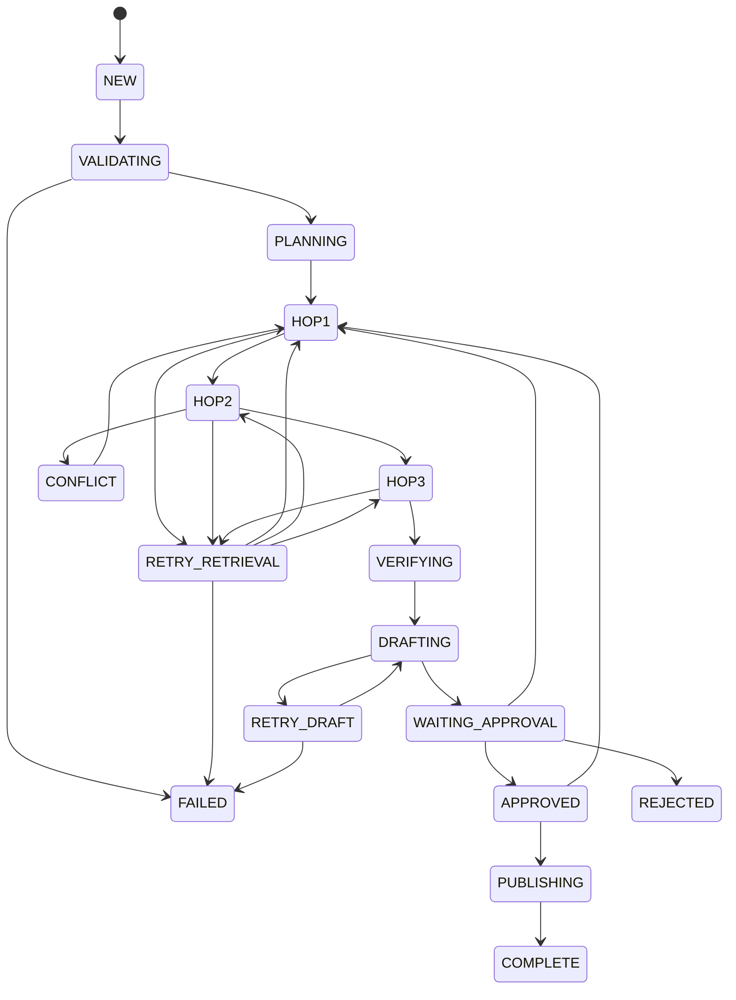

# Week 29 Knowledge Workflow Assistant

I built the policy-change scenario from the learning plan. The assistant follows three evidence steps, prepares an answer, pauses for review and resumes from its saved checkpoint. The expense authorization is a simulated example.

## Run

Open PowerShell, use cd to convert the workspace in this folder and run:

```powershell
.\run.ps1
```

Open http://127.0.0.1:8029. The terminal prints separate local tokens for user, reviewer-1 and admin. Paste the user token into the page and start the example question. Switch to the reviewer token to approve, edit or reject it with a reason. After approval or edit, press **Resume workflow** to publish. A rejection finishes the workflow.

The supported question form is **Can Employee A approve Expense X under the current policy?** Try employees A, B and C and expenses X, Y and Z. Unknown entities enter the bounded retry path.

Python 3.12 or newer is sufficient. This implementation uses the standard library. The launcher also works from another working directory. Runtime data is kept in `runtime/workflow.sqlite`, with its integrity key beside it. Back up both together.

## Architecture and evidence flow

```mermaid
flowchart LR
    UI[Local review page] --> API[Token and role checks]
    API --> SM[Explicit Python state machine]
    SM --> DB[SQLite checkpoints and signed records]
    DB --> HR[Hop 1 current employee role]
    HR --> Policy[Hop 2 current role limit]
    Policy --> Expense[Hop 3 expense and comparison]
    Expense --> Verify[Verify evidence chain]
    Verify --> Review[Human review]
    Review --> Publish[Publish approved content]
```



Hop 2 uses the role retrieved at Hop 1. Hop 3 uses the policy currency and limit retrieved at Hop 2. Each hop stores its query, dependencies, intermediate fact, document ID, version, effective date, source and checksum. An incorrect role at Hop 1 would send Hop 2 to the wrong limit. Increasing top-k alone would not express that dependency.

For this small set of records, I look up the sources directly in the registry. Each hop checks the current version. Code compares the role and amount and writes the answer from a template. Later, I could add an LLM to understand more ways of asking the question and still check permissions and state changes in code.

## State diagram



The complete transition table is `core.TRANSITIONS`. The three terminal states are COMPLETE, FAILED and REJECTED. Every step commits its changes with the checkpoint. Two failed retrieval or drafting attempts can be retried, and the third failure ends the run. Press Resume to retry. Conflicting sources pause until an admin corrects the source data.

| Stage | Input | Output |
|---|---|---|
| Validate | Question text | Employee and expense IDs |
| Plan | IDs | Three dependent subquestions |
| Hops 1–3 | Previous facts and current sources | Facts and evidence records |
| Verify | Three evidence records | Complete chain |
| Draft | Verified facts | Answer with source references |
| Review | Exact draft and versions | Reviewer identity, decision and reason |
| Publish | Matching approval | Published answer and evidence |

## Version policy and security

The registry keeps all versions. A new version must increase its document's version number. Current means the latest effective active version for that document, while later dates are scheduled. A rollback withdraws the target's successors and records the admin and reason. A newer unofficial document cannot pass the source-authority check.

If knowledge changes or the date rolls over, the workflow retrieves the evidence again and asks for a fresh approval. Conflicting current sources pause the run. I tie approval to the run, question, answer, evidence and source snapshot. That lets the backend catch a copied decision, an old revision or an unauthorized reviewer.

SQLite handles updates in transactions so two requests cannot change the same checkpoint at once. I sign the saved records with HMAC to detect direct changes. Someone with both the database and signing key could replace them, so that directory would need proper protection in real use. The local demo tokens are shown in the terminal and rotate after restart. Read access to the local demo is open. Production would need individual authenticated users, restricted reads, protected secrets and an external audit sink.

The publish stage records an answer inside this application. Idempotent resume prevents duplicate publication records. An external publishing service would need its own idempotency key or transactional outbox. Retrieved fields are treated as data and cannot select a transition.

## Tests and deliverables

```powershell
python -m unittest -v
python evaluate.py
```

Evaluation uses temporary databases and writes actual traces and test results to `reports`. It includes five current-policy regression questions and tests for three dependent hops, stale knowledge, updates, rollback, conflicts, restart, edit/reject, bounded retries, illegal transitions, tampered records, replay and cross-workflow approvals.

The client summary, source inventory, update audit, failure analysis and framework reconstruction are in [the engineering report](REPORT.md). The original task list stays in `Engineering_Assignment/Tasks.json`. All five engineering implementations are integrated in `core.py`, `app.py` and `evaluate.py`.

## Limits

I kept the first version small. It handles one question format and whole-number EUR amounts, and I can inspect all the simulated records by hand. Approval is required for every expense answer because this example concerns authorization. Human edits are recorded as reviewer overrides and can change the wording or conclusion. Reviewers are responsible for that content. Conflicts require an admin update before continuing. A production pilot would need independent policy owners, broader query evaluation and stronger separation between storage and audit administration.
